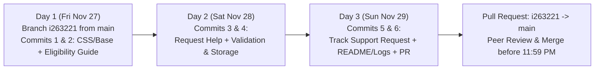

# Implementation Plan: Charitree Support Module (3-Day Plan)

## Goal Description
Build and integrate **3 cohesive, responsive, accessible pages** for **Charitree — Growing Hope Together** (Theme #45: *Charity and donation drive*) assigned to **Aiman Zahid (`26i-3221`, Section SE-A)**, branching cleanly from **`main`** (from scratch) and matching your hand-drawn **Horizontal & Vertical Paper Prototypes**:
1. **Eligibility Guide** (`pages/eligibility-guide.html`)
2. **Request Help** (`pages/request-help.html`)
3. **Track Support Request** (`pages/track-request.html`)

All work will be done on branch **`i263221`**, spread across **3 calendar days (Nov 27, Nov 28, Nov 29, 2026)** with **6 meaningful commits**, backed by exported Antigravity CLI session logs in `docs/ai-logs/26i-3221/`, and submitted via a **Pull Request into `main`** before **Sunday, 29th November 2026, 11:59 pm**.

---

## Prototype Fidelity Mapping

Every screen and interactive state from your chart paper is mapped directly into the implementation:

### Brand & Shared Layout (From Your Prototype + Palette)
- **Color Palette:** Primary Teal (`#1A535C`), Secondary Soft Sage (`#4ECDC4`), Accent Warm Coral (`#FF6B6B`), Background Off-White (`#F7FFF7`), Crisp White (`#FFFFFF`) card surfaces, high-contrast dark text (`#1B262C`).
- **Shared Header:** Brand logo + **`CHARITREE`** (`Growing Hope Together`), desktop nav (`Home` | `Campaign` | `Request Help` | `Eligibility` | `Track` + Warm Coral **`Donate Now`** CTA button), and responsive mobile hamburger menu (`☰`).
- **Shared Footer:** Consistent footer across all 3 pages with relative navigation links, contact info, and back-to-top link.

### 1. Eligibility Guide (`pages/eligibility-guide.html`)
- **Category Tabs:** Interactive tabs (`Medical` | `Education` | `Food Aid` | `Housing` | `Clean Water` | `All`) rendered from JS data (`SUPPORT_PROGRAMS`).
- **Check My Eligibility Calculator:** Two numeric/select inputs (Monthly Household Income in Rs., Household Size / Dependents) + document readiness checkbox + Warm Coral **`Calculate Eligibility`** button with validation and `localStorage` persistence (`charitree_eligibility_draft`) that can pre-fill `Request Help`.
- **Checklist Activity:** Interactive criteria checklist card (Medical criteria, Education criteria, Housing/Agency criteria, Accessibility/Document criteria) persisted in `localStorage`, plus accessible FAQ/Guidelines accordion and live keyword filter.

### 2. Request Help (`pages/request-help.html`)
- **Centered Form Card (Desktop & Mobile Prototype):**
  - **`Full Name`** (required, min length validation)
  - **`CNIC`** (required, Pakistani CNIC format `XXXXX-XXXXXXX-X` with live formatting/validation)
  - **`Category`** dropdown (`Medical`, `Education`, `Food Aid`, `Housing`, `Clean Water`)
  - **`Amount Needed`** (Rs., validated against numeric bounds & category cap)
  - Optional **`Reason / Urgency & Contact Email`** fields for depth + priority/review-time calculation
  - Warm Coral **`Submit Support Request`** CTA button
- **Depth & Persistence:** Live validation, draft auto-save (`charitree_request_draft`), pre-fill banner if arriving from Eligibility Guide, confirmation modal/summary, unique **`CHR-2026-XXX`** Tracking ID generation, and `localStorage` persistence (`charitree_support_requests`).

### 3. Track Support Request (`pages/track-request.html`)
Matches both your **Horizontal layout** (Search left + 4-step pipeline right) and **4-State Vertical Prototype**:
- **State 1 — Initial Search:** **`TRACKING ID`** input (format `CHR-2026-884`) + **`CNIC`** input + Warm Coral **`Track Request`** button + quick clickable sample ID chips (including a user's newly submitted IDs from `Request Help`).
- **State 2 — Validation Error:** Clear error panel (`ERROR: Invalid Tracking ID format (Use CHR-2026-884)` or invalid CNIC / not-found message).
- **State 3 — Active Request Found:** Progress bar (e.g., `PROGRESS: 75%`), 4-stage vertical/horizontal stepper (`1. Request Submitted` -> `2. Under Review` -> `3. Approved` -> `4. Funds Distributed`), and interactive **`Upload Document`** button/modal that attaches a verification document name/status and persists the update in `localStorage`.
- **State 4 — Funds Disbursed:** **`Status Updated 100%`** disbursement receipt card displaying **`Amount Rs: 50,000`** (or the actual case amount) and **`Date: 25 Nov 2026`**, plus case breakdown and print/pin support.

---

## User Review Required

> [!IMPORTANT]
> **Timing for Day 1 (Today — Friday, Nov 27, 2026)**
> - To ensure your Git history visibly spans **at least 3 calendar days (Nov 27, Nov 28, Nov 29)**, **Day 1 commits must be pushed before midnight tonight (Nov 27)**.
> - Note: Since `main` currently has only `README.md`, `Home` (`../index.html`), `Campaign`, and `Donate Now` in the navbar will link using standard relative paths (`../index.html`, etc.) that become active once the group merges all branches to `main`.

> [!NOTE]
> **6 Mandatory Feature Categories Coverage**
> 1. **Data & Display:** JS-rendered `SUPPORT_PROGRAMS`, `CHECKLIST_ITEMS`, `ELIGIBILITY_FAQS`, and `INITIAL_REQUESTS` + category tabs & search filter.
> 2. **Forms & Input:** Live & submit validation on `Check My Eligibility`, `Request Help` (CNIC, Name, Category, Amount), and `Track Support Request` (Tracking ID + CNIC).
> 3. **State & Memory:** `localStorage` persistence for eligibility result handoff, request form drafts, submitted requests, checklist toggles, and uploaded document updates.
> 4. **Interaction:** Category tabs, FAQ/checklist accordions, `Upload Document` modal, clickable sample Tracking ID chips, 4-stage progress stepper.
> 5. **Logic & Calculation:** Per-capita income & eligibility tier calculator + category aid cap & estimated review timeline calculation.
> 6. **Responsive & Accessible:** Mobile hamburger menu (matching mobile prototype), semantic HTML5 landmarks, skip link, `:focus-visible` rings, `aria-live` feedback, 375px mobile + desktop responsiveness.

---

## 3-Day Execution & Commit Schedule

### Day 1 — Friday, 27 November 2026 (Create Branch `i263221` + Page 1: Eligibility Guide)
* **Git Setup:** `git checkout -b i263221` from `main`.
* **Commit 1:** `Initialize branch i263221 with Charitree base styles, shared layout, and Eligibility Guide HTML`
  * #### [NEW] `css/style.css` — Complete Charitree design system (Teal `#1A535C`, Soft Sage `#4ECDC4`, Warm Coral `#FF6B6B`, Off-White `#F7FFF7`), header/navbar, mobile drawer, cards, tabs, forms, progress bar, 4-step stepper, modal, and footer.
  * #### [NEW] `pages/eligibility-guide.html` — Semantic HTML5 structure matching your Eligibility Guide prototype (Category tabs, `Check My Eligibility` card, `Checklist Activity` card, FAQ accordion).
* **Commit 2:** `Implement JS-driven eligibility programs, tier calculator, checklist persistence, and mobile nav`
  * #### [NEW] `js/support-data.js` — Program datasets (`SUPPORT_PROGRAMS`, `CHECKLIST_ITEMS`, `ELIGIBILITY_FAQS`, `INITIAL_REQUESTS`).
  * #### [NEW] `js/main.js` — Shared mobile menu drawer + Eligibility Guide interactive tabs, eligibility calculator logic, checklist persistence (`localStorage`), and accessible accordion.
* **Push Day 1:** `git push -u origin i263221` and export Day 1 Antigravity CLI log to `docs/ai-logs/26i-3221/session-01.md` (committed or saved with session).

### Day 2 — Saturday, 28 November 2026 (Page 2: Request Help)
* **Commit 3:** `Build Request Help page matching desktop and mobile paper prototypes`
  * #### [NEW] `pages/request-help.html` — Centered Request Help form (`Full Name`, `CNIC`, `Category`, `Amount Needed`, urgency/email, `Submit Support Request`), eligibility carry-over banner, and helpful submission summary panel.
* **Commit 4:** `Add Request Help live validation, CNIC formatting, aid cap logic, and localStorage persistence`
  * #### [MODIFY] `js/main.js` — CNIC (`XXXXX-XXXXXXX-X`) & amount validation, draft saving (`charitree_request_draft`), Eligibility Guide pre-fill, `CHR-2026-XXX` Tracking ID generation, `localStorage` storage (`charitree_support_requests`), and direct "Track This Request" handoff.
* **Push Day 2:** `git push origin i263221` and export Day 2 Antigravity CLI log.

### Day 3 — Sunday, 29 November 2026 (Page 3: Track Support Request + Docs + PR)
* **Commit 5:** `Implement Track Support Request page with 4-state vertical prototype flow`
  * #### [NEW] `pages/track-request.html` — Horizontal search + 4-stage pipeline layout implementing all 4 Vertical Prototype states: Initial Search (`Tracking ID` + `CNIC`), Validation Error (`ERROR: Invalid Tracking ID format (Use CHR-2026-884)`), Active Request Found (`Progress: 75%` + `Upload Document` modal), and Funds Disbursed (`Status Updated 100%` receipt card).
  * #### [MODIFY] `js/main.js` — Tracking ID & CNIC lookup, format error handling, `Upload Document` simulation persisted to `localStorage`, URL `?id=` auto-load, and sample Tracking ID chips.
* **Commit 6:** `Update README feature/contribution tables and add exported AI session logs for 26i-3221`
  * #### [MODIFY] `README.md` — Add Feature Table (`Feature | Category | Page | Member`) and Contribution Table (`Name | Roll No | Pages Built | Features Built`) for `Aiman Zahid (26i-3221)`.
  * #### [NEW] `docs/ai-logs/26i-3221/session-01.md`..`session-03.md` — Unedited exported Antigravity CLI session logs.
* **Push & Pull Request:** Push `i263221`, open PR `i263221 -> main` on GitHub, get peer approval from a group member, and merge to `main` before **11:59 pm, Nov 29**.

---

## Verification Plan

### Automated / CLI Checks
1. **JS Syntax Validation:** Run `node --check js/support-data.js; node --check js/main.js` after JS edits.
2. **Relative Path & Link Audit:** Verify all `href` and `src` paths in `pages/*.html` are relative (`../css/style.css`, `../js/support-data.js`, `../js/main.js`, `request-help.html`, etc.) with zero broken local targets among your files.
3. **Git History Audit:** Run `git log --stat --date=short` on `i263221` to confirm >= 5 meaningful commits across Nov 27, Nov 28, and Nov 29.

### Manual Browser Verification (Desktop & Mobile 375px)
1. **Eligibility Guide:** Switch category tabs (`Medical`, `Education`, `Food Aid`, `Housing`), run `Calculate Eligibility` with invalid and valid inputs, check/uncheck `Checklist Activity` items, and reload to confirm persistence.
2. **Request Help:** Verify Eligibility pre-fill, test invalid CNIC/empty fields/excess amount errors, submit valid form, verify `CHR-2026-XXX` ID generation, and click through to `Track Support Request`.
3. **Track Support Request:** Test all 4 Vertical Prototype states — initial empty search, invalid format (`ERROR: Invalid Tracking ID format (Use CHR-2026-884)`), active 75% request + `Upload Document` update, and 100% `Funds Disbursed` receipt card (`Amount Rs: 50,000`, `Date: 25 Nov 2026`).
4. **Responsive & Accessibility:** Test mobile hamburger drawer (`☰`), keyboard `Tab` focus indicators, and zero horizontal scrolling at `375px`.
